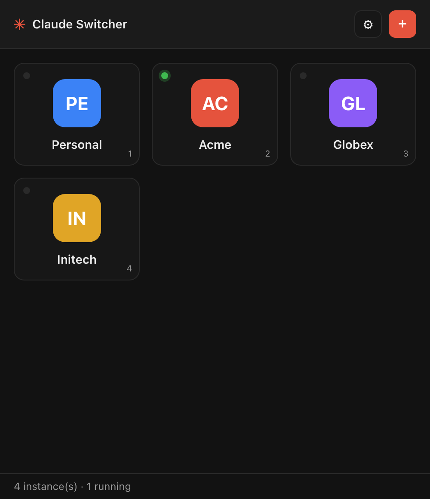

# Claude Switcher

A small desktop launcher that opens several Claude Desktop instances, one per organization or account, with a click. Works on macOS and Windows.

> Unofficial. Not affiliated with or endorsed by Anthropic. Claude is a trademark of Anthropic, PBC.

<p align="center">
  
</p>

## Why

Claude Desktop signs in to one account at a time. If you belong to several organizations, you log out and back in every time you switch. The app is built on Electron, which accepts the standard Chromium flag `--user-data-dir`. Point it at a different folder and you get an independent copy of Claude with its own login, chat history and connectors.

Claude Switcher keeps a list of those folders, shows each one as a card with a name and an icon, and runs the right command when you click:

- macOS: `open -n -a /Applications/Claude.app --args --user-data-dir=<folder>`
- Windows: `%LOCALAPPDATA%\AnthropicClaude\claude.exe --user-data-dir=<folder>`

That is all it does. It never touches the Claude app itself, your `~/.claude` folder, or the network.

## Features

- Cards with a custom image or colored initials. Click to launch.
- A green dot marks instances that are already running. Clicking one brings its window to the front instead of opening a duplicate.
- Keys `1` to `9` launch the Nth card.
- A built-in "Claude" card (key `0`) and tray entry open the regular profile, with no `--user-data-dir`. Useful because once an instance is running, clicking Claude in the Dock or Start menu only brings that instance forward instead of opening the regular app.
- Lives in the menu bar (macOS) or system tray (Windows). Closing the window keeps the app running there; click the tray icon to pick an instance, reopen the window, or quit. On macOS the Dock icon disappears while the window is closed.
- About dialog with version, author and repository link, in the app and in the tray menu.
- The menu bar shows the name of the instance whose Claude window is frontmost (tooltip on Windows), and the matching card is outlined.
- Global shortcuts: Ctrl+Alt+1 to 9 (Control+Option on macOS) bring instance N to the front from any app, Ctrl+Alt+0 the regular profile. Can be turned off in Settings.
- Export the configuration to a JSON file and import it back, merging or replacing the list.
- English and Spanish, following the system language, with an override in Settings.
- Search, All/Running/Stopped filter, grid or list view, and a per-card menu (edit, reveal folder, quit, remove).
- macOS: each instance gets its own Dock icon. The app launches it from an APFS clone of Claude.app (no extra disk, under a second to create) whose Finder icon is the instance avatar. Finder icons live outside the code signature, so Gatekeeper and the Keychain keep working. Can be turned off in Settings.
- Imports any folders already present in `~/.claude-instances` on first run.
- Detects the Claude install path on both platforms; you can override it in Settings.
- Configuration lives in a single `config.json` under the OS app-config directory. The path is shown in Settings.

## Privacy

Claude Switcher stores no credentials. It never sees your password, session cookies or API tokens: you sign in inside Claude Desktop itself, exactly as you would without the launcher, and Claude keeps that session in the data folder of that instance. The only file the launcher writes is its own `config.json`, which holds the name, folder path, color and optional icon of each instance. It makes no network requests.

## Install

Download the latest build from the [Releases](../../releases) page.

### macOS

Install with Homebrew:

```bash
brew install --cask efideas/tap/claude-switcher
```

The cask clears the Gatekeeper quarantine flag for you, since the app is not notarized yet. To remove the app and its data later, run `brew uninstall --zap --cask claude-switcher`.

Or install by hand:

1. Open the `.dmg` and drag Claude Switcher to Applications.
2. The app is not notarized yet, so the first launch is blocked by Gatekeeper. Right-click the app, choose Open, then Open again. You only need to do this once. The equivalent command is:

   ```bash
   xattr -d com.apple.quarantine "/Applications/Claude Switcher.app"
   ```

### Windows

Run the `.exe` installer (NSIS) or the `.msi`. Windows SmartScreen may warn that the publisher is unknown because the binary is not code signed. Choose "More info" and then "Run anyway".

### Sign-in tips

- When you sign in to a new instance for the first time, close the other Claude windows first. The login deep link always lands in whichever Claude process is already running.
- When Claude updates itself it may relaunch without the flag and land in the default profile. Quit it and open it again from Claude Switcher.

## Development and distribution

- [docs/development.md](docs/development.md): requirements, commands, and the project layout.
- [docs/distribution.md](docs/distribution.md): releases, the Homebrew tap, Windows package managers, code signing and in-app updates.

## Limitations

- `--user-data-dir` is a Chromium flag, not an Anthropic feature. A future Claude release could change how it behaves.
- Only the desktop app is isolated. Claude Code (the CLI) uses `~/.claude`; set `CLAUDE_CONFIG_DIR` in your shell if you need separate CLI profiles too.
- Google and SSO logins open the system browser, which hands the token back to whichever Claude process is running. See the sign-in tips above.

## License

MIT. See [LICENSE](LICENSE).
